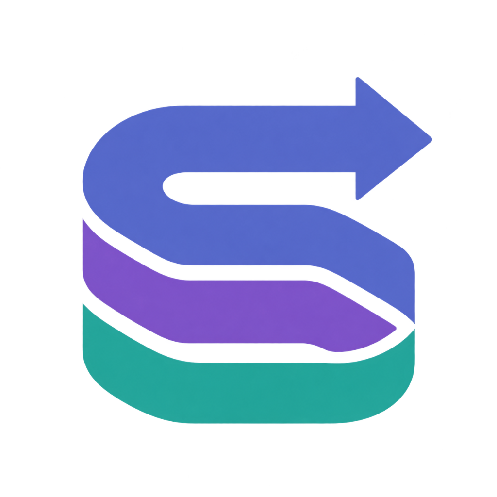
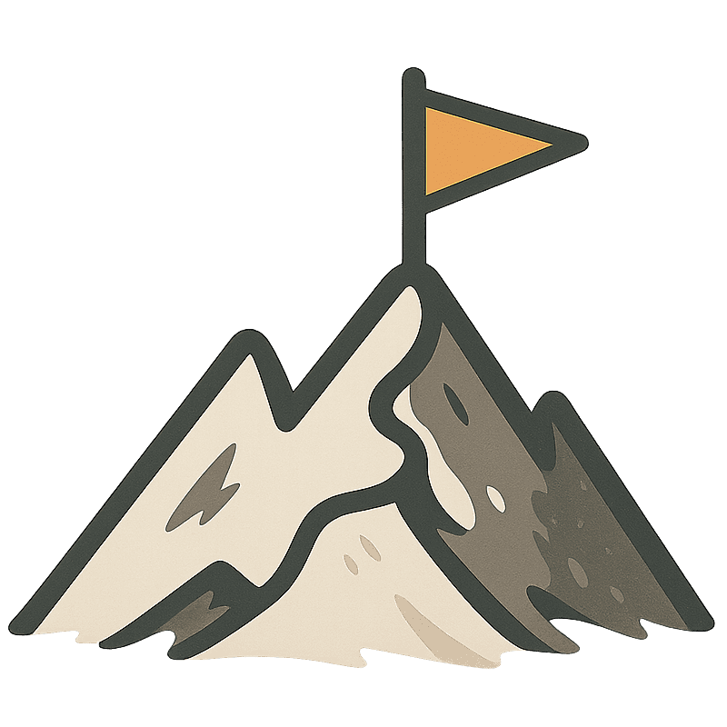

<div class="sf-hero" data-lang="ja" markdown>

<svg class="sf-px-clouds" viewBox="0 0 960 120" aria-hidden="true" shape-rendering="crispEdges">
  <g transform="translate(28,18)">
    <rect x="24" y="0" width="40" height="8" fill="#1E242B"/>
    <rect x="16" y="8" width="56" height="8" fill="#1E242B"/>
    <rect x="8" y="16" width="76" height="8" fill="#1E242B"/>
    <rect x="0" y="24" width="92" height="16" fill="#1E242B"/>
    <rect x="8" y="40" width="76" height="8" fill="#1E242B"/>
    <rect x="24" y="8" width="40" height="8" fill="#FFFDF7"/>
    <rect x="16" y="16" width="60" height="8" fill="#FFFDF7"/>
    <rect x="8" y="24" width="76" height="12" fill="#FFFDF7"/>
    <rect x="12" y="34" width="68" height="6" fill="#D5E3EE"/>
  </g>
  <g transform="translate(824,14)">
    <rect x="28" y="0" width="44" height="8" fill="#1E242B"/>
    <rect x="16" y="8" width="68" height="8" fill="#1E242B"/>
    <rect x="8" y="16" width="84" height="8" fill="#1E242B"/>
    <rect x="0" y="24" width="100" height="16" fill="#1E242B"/>
    <rect x="8" y="40" width="84" height="8" fill="#1E242B"/>
    <rect x="28" y="8" width="44" height="8" fill="#FFFDF7"/>
    <rect x="16" y="16" width="68" height="8" fill="#FFFDF7"/>
    <rect x="8" y="24" width="84" height="12" fill="#FFFDF7"/>
    <rect x="12" y="34" width="76" height="6" fill="#D5E3EE"/>
  </g>
</svg>

<div class="sf-hero-logo-wrap">

</div>

# Steerable

<p class="sf-tagline"><span class="sf-ribbon">◆ ローカル・低コストモデル向けの品質レイヤー ◆</span></p>

<p class="sf-pills">
<a href="#pillar-1" class="sf-pill">ハルシネーション抑制</a>
<a href="#pillar-2" class="sf-pill">シンプル設計</a>
<a href="#pillar-3" class="sf-pill">すぐ使える</a>
<a href="#pillar-4" class="sf-pill">レイヤー分離</a>
</p>

<p class="sf-sub" markdown>
GLM-5.3-Flash で Terminal-Bench 2.1 **79.0%**。1 コマンドで起動、または必要な層だけ組み込み。
</p>

<div class="sf-cta" markdown>
<a href="#run" class="md-button md-button--primary">1 コマンドで起動</a>
<a href="../demo/" class="md-button">ライブデモ</a>
</div>

<p class="sf-cta-secondary" markdown>
[はじめに](../getting-started.md) · <a href="../storybook/">Storybook</a> · [GitHub](https://github.com/pathlyapp/steerable)
</p>

<p class="sf-badges">
  <a href="https://github.com/pathlyapp/steerable/blob/main/LICENSE"></a>
  <a href="https://www.npmjs.com/package/@steerable/agent-ui"></a>
  <a href="https://pypi.org/project/steerable-agent-runtime/"></a>
</p>

<svg class="sf-px-ground" viewBox="0 0 960 64" preserveAspectRatio="none" aria-hidden="true" shape-rendering="crispEdges">
  <rect x="0" y="32" width="144" height="32" fill="#8B5A30"/>
  <rect x="0" y="24" width="152" height="12" fill="#2FA858"/>
  <rect x="0" y="20" width="144" height="6" fill="#46C96E"/>
  <rect x="144" y="40" width="64" height="24" fill="#8B5A30"/>
  <rect x="144" y="34" width="72" height="10" fill="#2FA858"/>
  <rect x="208" y="48" width="552" height="16" fill="#8B5A30"/>
  <rect x="208" y="44" width="552" height="8" fill="#2FA858"/>
  <rect x="208" y="42" width="552" height="3" fill="#46C96E"/>
  <rect x="24" y="42" width="16" height="8" fill="#6E4421"/>
  <rect x="84" y="48" width="20" height="8" fill="#6E4421"/>
  <rect x="310" y="52" width="24" height="6" fill="#6E4421"/>
  <rect x="520" y="54" width="24" height="6" fill="#6E4421"/>
  <rect x="640" y="50" width="20" height="6" fill="#6E4421"/>
  <rect x="34" y="0" width="4" height="22" fill="#1E242B"/>
  <rect x="38" y="2" width="26" height="14" fill="#1E242B"/>
  <rect x="40" y="4" width="22" height="10" fill="#229659"/>
  <rect x="47" y="6" width="8" height="2" fill="#FFFDF7"/>
  <rect x="47" y="8" width="2" height="2" fill="#FFFDF7"/>
  <rect x="47" y="9" width="8" height="2" fill="#FFFDF7"/>
  <rect x="53" y="10" width="2" height="2" fill="#FFFDF7"/>
  <rect x="47" y="11" width="8" height="2" fill="#FFFDF7"/>
  <rect x="752" y="40" width="64" height="24" fill="#8B5A30"/>
  <rect x="744" y="34" width="72" height="10" fill="#2FA858"/>
  <rect x="816" y="32" width="144" height="32" fill="#8B5A30"/>
  <rect x="808" y="24" width="152" height="12" fill="#2FA858"/>
  <rect x="816" y="20" width="144" height="6" fill="#46C96E"/>
  <rect x="880" y="46" width="18" height="8" fill="#6E4421"/>
  <rect x="922" y="2" width="4" height="20" fill="#1E242B"/>
  <rect x="896" y="4" width="26" height="14" fill="#1E242B"/>
  <rect x="898" y="6" width="22" height="10" fill="#EA7A2E"/>
  <rect x="905" y="8" width="8" height="2" fill="#FFFDF7"/>
  <rect x="905" y="10" width="8" height="2" fill="#FFFDF7"/>
  <rect x="905" y="12" width="8" height="2" fill="#FFFDF7"/>
  <rect x="260" y="36" width="4" height="6" fill="#2FA858"/>
  <rect x="258" y="34" width="8" height="4" fill="#F59E0B"/>
  <rect x="690" y="36" width="4" height="6" fill="#2FA858"/>
  <rect x="688" y="34" width="8" height="4" fill="#3B82F6"/>
</svg>

</div>

<div class="sf-score-strip" markdown>
<div class="sf-score sf-score--ours" markdown>
<span class="sf-score-value">79.0%</span>
<span class="sf-score-label">Steerable + GLM-5.3-Flash</span>
<span class="sf-score-meta">TB 2.1 · @max 3 回平均 · 本リポジトリ</span>
</div>
<div class="sf-score" markdown>
<span class="sf-score-value">+5.6</span>
<span class="sf-score-label">同一 Flash モデルで P&#42; 比</span>
<span class="sf-score-meta">P&#42; + GLM-5.3-Flash · 73.4%</span>
</div>
<div class="sf-score" markdown>
<span class="sf-score-value">229.9M</span>
<span class="sf-score-label">カタログ 1 周あたりの入力トークン</span>
<span class="sf-score-meta">3 回平均 · 従来ベースライン比 15.4% 削減</span>
</div>
</div>

<nav class="sf-subnav" aria-label="ページ内ナビ">
<a href="#run">クイック起動</a>
<a href="#why">選ばれる理由</a>
<a href="#bench">ベンチマーク</a>
<a href="#inside">主要機能</a>
<a href="#quickstart">導入方法</a>
<a href="#architecture">5 層構造</a>
<a href="#packages">パッケージ</a>
<a href="#compare">比較</a>
<a href="#users">採用事例</a>
</nav>

<div class="sf-run" id="run">
<div class="sf-run-copy">
<span class="sf-pillar-kicker">すぐ始められる</span>
<p class="sf-run-title">1 コマンドでフル機能のエージェント</p>
<p class="sf-run-text">チャット・端末・サンドボックスを標準搭載。ブラウザ、デスクトップ、CLI で共通動作。</p>
<a href="#quickstart" class="md-button">組み込み方法を見る</a>
</div>
<div class="sf-run-term">
<input type="radio" name="sf-run-mode" id="sf-run-web" class="sf-run-radio" checked>
<input type="radio" name="sf-run-mode" id="sf-run-desktop" class="sf-run-radio">
<input type="radio" name="sf-run-mode" id="sf-run-cli" class="sf-run-radio">
<div class="sf-run-bar" role="tablist" aria-label="起動モード">
<div class="sf-run-dots" aria-hidden="true"><span></span><span></span><span></span></div>
<div class="sf-run-tabs">
<label for="sf-run-web" role="tab" aria-selected="true" tabindex="0">Web</label>
<label for="sf-run-desktop" role="tab" aria-selected="false" tabindex="-1">デスクトップ</label>
<label for="sf-run-cli" role="tab" aria-selected="false" tabindex="-1">CLI</label>
</div>
<button type="button" class="sf-run-copy" aria-label="コマンドをコピー">
<span class="sf-run-copy-text">コピー</span>
</button>
</div>
<div class="sf-run-pane sf-run-pane--web" role="tabpanel">
<pre><code><span class="sf-cmd">git clone https://github.com/pathlyapp/steerable.git</span>
<span class="sf-cmd">cd steerable &amp;&amp; pnpm install</span>
<span class="sf-cmd"><b>pnpm agent-shell:web</b></span></code></pre>
<div class="sf-out">→ Steerable Shell が http://127.0.0.1:4787 で待機中</div>
</div>
<div class="sf-run-pane sf-run-pane--desktop" role="tabpanel">
<pre><code><span class="sf-cmd"># shell crate を組み込んだ製品リポジトリの src-tauri で実行</span>
<span class="sf-cmd"><b>pnpm tauri dev</b></span></code></pre>
<div class="sf-out">→ 同一のホストランタイムと Sidecar でネイティブウィンドウを起動</div>
</div>
<div class="sf-run-pane sf-run-pane--cli" role="tabpanel">
<pre><code><span class="sf-cmd">npm install -g @steerable/agent-cli</span>
<span class="sf-cmd"><b>steerable-cli login</b></span>
<span class="sf-cmd">steerable-cli run "summarize this repo"</span></code></pre>
<div class="sf-out">→ 1 回のインストールでランタイム同梱。login でキー検証（Node 22.19+、TUI は 26.4 必須）</div>
</div>
</div>
</div>

<h2 class="sf-section" id="why">なぜ Steerable か</h2>

<p class="sf-lede" markdown>
モデルの完全な従順さを前提とせず、ツール復元・根拠検証・隔離を確実に強制します。
</p>

<div class="sf-pillars" markdown>
<div class="sf-pillar" id="pillar-1" markdown>
<span class="sf-pillar-kicker">01 · ハルシネーション抑制</span>
### 根拠ある出力へ
根拠なき回答や未実施報告を弾き、不正なテキストツール出力を自動復元して再試行。
</div>
<div class="sf-pillar" id="pillar-2" markdown>
<span class="sf-pillar-kicker">02 · シンプル設計</span>
### DSL 不要の素直な設計
グラフ DSL 不要。通常の `@tool` 関数、I/O ゼロの Harness、単一 Schema から型生成。
</div>
<div class="sf-pillar" id="pillar-3" markdown>
<span class="sf-pillar-kicker">03 · すぐ使える</span>
### 初期状態から安全
Seatbelt / bwrap / Windows 隔離、61 ルール分類器、出口プロキシ内蔵。[デモ](../demo/)もキー不要。
</div>
<div class="sf-pillar" id="pillar-4" markdown>
<span class="sf-pillar-kicker">04 · レイヤー分離</span>
### 必要な層だけを採用
5 層 15 パッケージ、上位依存なし。Protocol・UI・Sidecar 単体でも導入可能。
</div>
</div>

<div class="sf-loop-stage" id="loop-stage" data-focus="all">
<div class="sf-loop-head">
<span class="sf-loop-badge">◆ 1 つのループ · 2 つの配備形態 ◆</span>
<div class="sf-loop-controls" role="toolbar" aria-label="CoreLoop の配備形態を確認">
<button type="button" class="sf-loop-btn is-active" data-target="all" aria-pressed="true">全体</button>
<button type="button" class="sf-loop-btn" data-target="core" aria-pressed="false">CoreLoop</button>
<button type="button" class="sf-loop-btn" data-target="desktop" aria-pressed="false">デスクトップ &amp; TUI</button>
<button type="button" class="sf-loop-btn" data-target="server" aria-pressed="false">サーバー</button>
</div>
</div>

<div class="sf-svg-scroll">
<svg class="sf-loop-svg" viewBox="0 0 820 248" role="img" aria-label="単一の CoreLoop がデスクトップ＆ターミナルと FastAPI サーバーの両方を駆動する図。" shape-rendering="crispEdges">
  <g class="sf-pipe-group">
    <path class="sf-pipe-bg" d="M368 150 L368 184 L216 184 L216 168" fill="none" stroke="#1E242B" stroke-width="14" stroke-linejoin="miter"/>
    <path class="sf-pipe-fill" d="M368 150 L368 184 L216 184 L216 168" fill="none" stroke="#229659" stroke-width="8" stroke-linejoin="miter"/>
    <path class="sf-pipe-pulse" d="M368 150 L368 184 L216 184 L216 168" fill="none" stroke="#FEF08A" stroke-width="4" stroke-dasharray="10 18"/>
    <path class="sf-pipe-bg" d="M452 150 L452 184 L604 184 L604 168" fill="none" stroke="#1E242B" stroke-width="14" stroke-linejoin="miter"/>
    <path class="sf-pipe-fill" d="M452 150 L452 184 L604 184 L604 168" fill="none" stroke="#229659" stroke-width="8" stroke-linejoin="miter"/>
    <path class="sf-pipe-pulse" d="M452 150 L452 184 L604 184 L604 168" fill="none" stroke="#FEF08A" stroke-width="4" stroke-dasharray="10 18"/>
    <rect x="358" y="144" width="20" height="8" fill="#1FA866" stroke="#1E242B" stroke-width="3"/>
    <rect x="442" y="144" width="20" height="8" fill="#1FA866" stroke="#1E242B" stroke-width="3"/>
  </g>

  <g class="sf-loop-node" data-node="desktop" tabindex="0" role="button" aria-label="デスクトップとターミナルを確認">
    <rect x="28" y="24" width="236" height="146" fill="#1E242B"/>
    <rect x="22" y="18" width="236" height="146" fill="#FFFDF7" stroke="#1E242B" stroke-width="4"/>
    <rect x="22" y="18" width="236" height="24" fill="#1E8250" stroke="#1E242B" stroke-width="4"/>
    <rect x="34" y="26" width="8" height="8" fill="#EA7A2E"/>
    <rect x="46" y="26" width="8" height="8" fill="#FACC15"/>
    <rect x="58" y="26" width="8" height="8" fill="#86EFAC"/>
    <rect x="66" y="54" width="54" height="38" fill="#1E242B"/>
    <rect x="70" y="58" width="46" height="28" fill="#3B82F6"/>
    <rect x="89" y="64" width="8" height="2" fill="#FFFDF7"/>
    <rect x="89" y="66" width="2" height="4" fill="#FFFDF7"/>
    <rect x="89" y="70" width="8" height="2" fill="#FFFDF7"/>
    <rect x="95" y="72" width="2" height="4" fill="#FFFDF7"/>
    <rect x="89" y="76" width="8" height="2" fill="#FFFDF7"/>
    <rect x="86" y="92" width="14" height="6" fill="#1E242B"/>
    <rect x="78" y="96" width="30" height="4" fill="#1E242B"/>
    <rect x="138" y="54" width="54" height="46" fill="#1E242B"/>
    <rect x="142" y="58" width="46" height="38" fill="#18202C"/>
    <rect x="150" y="68" width="4" height="4" fill="#4ADE80"/>
    <rect x="154" y="72" width="4" height="4" fill="#4ADE80"/>
    <rect x="150" y="76" width="4" height="4" fill="#4ADE80"/>
    <rect x="162" y="78" width="12" height="4" fill="#4ADE80"/>
    <text class="sf-svg-title" x="140" y="124" text-anchor="middle">デスクトップ &amp; 端末</text>
    <rect x="56" y="134" width="168" height="22" fill="#1E8250" stroke="#1E242B" stroke-width="3"/>
    <text class="sf-svg-pill" x="140" y="149" text-anchor="middle">Tauri アプリ / CLI &amp; TUI</text>
  </g>

  <g class="sf-loop-node" data-node="core" tabindex="0" role="button" aria-label="CoreLoop を確認">
    <rect x="392" y="22" width="36" height="14" fill="#1FA866" stroke="#1E242B" stroke-width="4"/>
    <rect x="392" y="142" width="36" height="14" fill="#1FA866" stroke="#1E242B" stroke-width="4"/>
    <rect x="336" y="72" width="14" height="34" fill="#1FA866" stroke="#1E242B" stroke-width="4"/>
    <rect x="470" y="72" width="14" height="34" fill="#1FA866" stroke="#1E242B" stroke-width="4"/>
    <rect x="352" y="40" width="22" height="22" fill="#1FA866" stroke="#1E242B" stroke-width="4"/>
    <rect x="446" y="40" width="22" height="22" fill="#1FA866" stroke="#1E242B" stroke-width="4"/>
    <rect x="352" y="116" width="22" height="22" fill="#1FA866" stroke="#1E242B" stroke-width="4"/>
    <rect x="446" y="116" width="22" height="22" fill="#1FA866" stroke="#1E242B" stroke-width="4"/>
    <rect x="350" y="36" width="120" height="106" fill="#1FA866" stroke="#1E242B" stroke-width="4"/>
    <rect x="362" y="48" width="96" height="72" fill="#FFFDF7" stroke="#1E242B" stroke-width="3"/>
    <rect x="374" y="68" width="28" height="24" fill="none" stroke="#EA7A2E" stroke-width="6"/>
    <rect x="418" y="68" width="28" height="24" fill="none" stroke="#1E8250" stroke-width="6"/>
    <rect x="404" y="74" width="12" height="12" fill="#F59E0B"/>
    <rect x="356" y="116" width="108" height="28" fill="#1E242B"/>
    <rect x="359" y="119" width="102" height="22" fill="#1E8250"/>
    <text class="sf-svg-core" x="410" y="135" text-anchor="middle">CoreLoop</text>
  </g>

  <g class="sf-loop-node" data-node="server" tabindex="0" role="button" aria-label="サーバーを確認">
    <rect x="568" y="24" width="236" height="146" fill="#1E242B"/>
    <rect x="562" y="18" width="236" height="146" fill="#FFFDF7" stroke="#1E242B" stroke-width="4"/>
    <rect x="562" y="18" width="236" height="24" fill="#2563EB" stroke="#1E242B" stroke-width="4"/>
    <rect x="574" y="26" width="8" height="8" fill="#EA7A2E"/>
    <rect x="586" y="26" width="8" height="8" fill="#FACC15"/>
    <rect x="598" y="26" width="8" height="8" fill="#86EFAC"/>
    <rect x="640" y="50" width="80" height="14" fill="#94A3B8" stroke="#1E242B" stroke-width="3"/>
    <rect x="648" y="55" width="8" height="4" fill="#1E242B"/>
    <rect x="706" y="55" width="6" height="4" fill="#38BDF8"/>
    <rect x="640" y="68" width="80" height="14" fill="#94A3B8" stroke="#1E242B" stroke-width="3"/>
    <rect x="648" y="73" width="8" height="4" fill="#1E242B"/>
    <rect x="706" y="73" width="6" height="4" fill="#4ADE80"/>
    <rect x="640" y="86" width="80" height="14" fill="#94A3B8" stroke="#1E242B" stroke-width="3"/>
    <rect x="648" y="91" width="8" height="4" fill="#1E242B"/>
    <rect x="706" y="91" width="6" height="4" fill="#FACC15"/>
    <text class="sf-svg-title" x="680" y="124" text-anchor="middle">サーバー</text>
    <rect x="596" y="134" width="168" height="22" fill="#2563EB" stroke="#1E242B" stroke-width="3"/>
    <text class="sf-svg-pill" x="680" y="149" text-anchor="middle">FastAPI SSE / Python</text>
  </g>

  <rect x="200" y="206" width="420" height="32" fill="#1E242B"/>
  <rect x="204" y="208" width="412" height="26" fill="#1E8250"/>
  <text class="sf-svg-ribbon" x="410" y="226" text-anchor="middle">◆ 同一ループ · 両端配備 · 強型プロトコル ◆</text>
</svg>
</div>

<p class="sf-loop-caption" id="sf-loop-caption">
単一の Rust <code>CoreLoop</code> が <code>LoopEvent</code> を介してデスクトップ Sidecar と FastAPI サーバーの両方を駆動します。
</p>
</div>

<h2 class="sf-section" id="bench">Flash クラスモデルのベンチマーク</h2>

<p class="sf-lede" markdown>
Terminal-Bench 2.1（89 問）。<strong>79.0%</strong> は GLM-5.3-Flash <code>@max</code> の 3 回平均、下図は単発 <code>n=1</code> 比較。[評価手法](../evals.md)
</p>

<div class="sf-bench sf-bench--wide">

<div class="sf-bench-toolbar" role="toolbar" aria-label="エージェント別ハイライト">
<span class="sf-bench-toolbar-label">ハイライト：</span>
<button type="button" class="sf-bench-filter is-active" data-harness="all" aria-pressed="true">すべて</button>
<button type="button" class="sf-bench-filter" data-harness="steer" aria-pressed="false"><i class="sf-swatch sf-swatch--steer"></i>Steerable</button>
<button type="button" class="sf-bench-filter" data-harness="pi" aria-pressed="false"><i class="sf-swatch sf-swatch--pi"></i>P*</button>
<button type="button" class="sf-bench-filter" data-harness="cc" aria-pressed="false"><i class="sf-swatch sf-swatch--cc"></i>C* C*</button>
<button type="button" class="sf-bench-filter" data-harness="codex" aria-pressed="false"><i class="sf-swatch sf-swatch--codex"></i>C*</button>
<button type="button" class="sf-bench-filter" data-harness="dsh" aria-pressed="false"><i class="sf-swatch sf-swatch--dsh"></i>D* H*</button>
</div>

<div class="sf-bench-duo">

<div class="sf-bench-group sf-bench-group--focus">
<div class="sf-bench-kicker">通過率 · 3 モデル × 5 ハーネス</div>
<p class="sf-bench-blurb">89 問中の正答率。棒グラフにカーソルを合わせると詳細を表示します。</p>
<div class="sf-svg-scroll">
<svg class="sf-bars" viewBox="0 0 760 336" role="img" aria-label="Terminal-Bench 2.1 における 3 モデル × 5 ハーネスの通過率比較。">
<line class="axis" x1="56" y1="48" x2="56" y2="280"/>
<line class="axis" x1="56" y1="280" x2="730" y2="280"/>
<text class="tick" x="50" y="284" text-anchor="end">0</text>
<text class="tick" x="50" y="219" text-anchor="end">25</text>
<text class="tick" x="50" y="154" text-anchor="end">50</text>
<text class="tick" x="50" y="89" text-anchor="end">75</text>
<text class="tick" x="50" y="58" text-anchor="end">89</text>
<line class="grid" x1="56" y1="215" x2="730" y2="215"/>
<line class="grid" x1="56" y1="150" x2="730" y2="150"/>
<line class="grid" x1="56" y1="85" x2="730" y2="85"/>
<line class="grid" x1="56" y1="54" x2="730" y2="54"/>
<rect class="bar--steer" data-tip="Steerable · GLM @high: 79.8% (71/89)" fill="#5c6bc0" x="79" y="99.6" width="22" height="180.4"/>
<rect class="bar--pi" data-tip="P* · GLM @high: 73.0% (65/89)" fill="#0e7490" x="107" y="114.9" width="22" height="165.1"/>
<rect class="bar--cc" data-tip="C* C* · GLM @high: 77.5% (69/89)" fill="#c2410c" x="135" y="104.7" width="22" height="175.3"/>
<rect class="bar--codex" data-tip="C* · GLM @high: 56.2% (50/89)" fill="#a1a1aa" x="163" y="153.0" width="22" height="127.0"/>
<rect class="bar--dsh" data-tip="D* H* · GLM @high: 66.3% (59/89)" fill="#15803d" x="191" y="130.2" width="22" height="149.8"/>
<text class="barVal" x="90" y="95" text-anchor="middle">79.8</text>
<text class="barVal" x="118" y="110" text-anchor="middle">73.0</text>
<text class="barVal" x="146" y="100" text-anchor="middle">77.5</text>
<text class="barVal" x="174" y="149" text-anchor="middle">56.2</text>
<text class="barVal" x="202" y="125" text-anchor="middle">66.3</text>
<text class="axisTitle" x="146" y="298" text-anchor="middle">GLM @high</text>
<rect class="bar--steer" data-tip="Steerable · DS0731 @high: 78.7% (70/89)" fill="#5c6bc0" x="303" y="102.1" width="22" height="177.9"/>
<rect class="bar--pi" data-tip="P* · DS0731 @high: 69.7% (62/89)" fill="#0e7490" x="331" y="122.5" width="22" height="157.5"/>
<rect class="bar--cc" data-tip="C* C* · DS0731 @high: 44.9% (40/89)" fill="#c2410c" x="359" y="178.4" width="22" height="101.6"/>
<rect class="bar--codex" data-tip="C* · DS0731 @high: 61.8% (55/89)" fill="#a1a1aa" x="387" y="140.3" width="22" height="139.7"/>
<rect class="bar--dsh" data-tip="D* H* · DS0731 @high: 77.5% (69/89)" fill="#15803d" x="415" y="104.8" width="22" height="175.2"/>
<text class="barVal" x="314" y="98" text-anchor="middle">78.7</text>
<text class="barVal" x="342" y="118" text-anchor="middle">69.7</text>
<text class="barVal" x="370" y="174" text-anchor="middle">44.9</text>
<text class="barVal" x="398" y="136" text-anchor="middle">61.8</text>
<text class="barVal" x="426" y="100" text-anchor="middle">77.5</text>
<text class="axisTitle" x="370" y="298" text-anchor="middle">DS0731 @high</text>
<rect class="bar--steer" data-tip="Steerable · Qwen @medium: 68.5% (61/89)" fill="#5c6bc0" x="527" y="125.0" width="22" height="155.0"/>
<rect class="bar--pi" data-tip="P* · Qwen @medium: 62.9% (56/89)" fill="#0e7490" x="555" y="137.8" width="22" height="142.2"/>
<rect class="bar--cc" data-tip="C* C* · Qwen @medium: 70.8% (63/89)" fill="#c2410c" x="583" y="120.0" width="22" height="160.0"/>
<rect class="bar--codex" data-tip="C* · Qwen @medium: 64.0% (57/89)" fill="#a1a1aa" x="611" y="135.2" width="22" height="144.8"/>
<rect class="bar--dsh" data-tip="D* H* · Qwen @medium: 60.7% (54/89)" fill="#15803d" x="639" y="142.9" width="22" height="137.1"/>
<text class="barVal" x="538" y="121" text-anchor="middle">68.5</text>
<text class="barVal" x="566" y="133" text-anchor="middle">62.9</text>
<text class="barVal" x="594" y="116" text-anchor="middle">70.8</text>
<text class="barVal" x="622" y="131" text-anchor="middle">64.0</text>
<text class="barVal" x="650" y="138" text-anchor="middle">60.7</text>
<text class="axisTitle" x="594" y="298" text-anchor="middle">Qwen @medium</text>
<rect class="bar--steer" fill="#5c6bc0" x="56" y="314" width="10" height="10"/>
<text class="tick" x="70" y="323">Steerable</text>
<rect class="bar--pi" fill="#0e7490" x="148" y="314" width="10" height="10"/>
<text class="tick" x="162" y="323">P*</text>
<rect class="bar--cc" fill="#c2410c" x="198" y="314" width="10" height="10"/>
<text class="tick" x="212" y="323">C* C*</text>
<rect class="bar--codex" fill="#a1a1aa" x="276" y="314" width="10" height="10"/>
<text class="tick" x="290" y="323">C*</text>
<rect class="bar--dsh" fill="#15803d" x="332" y="314" width="10" height="10"/>
<text class="tick" x="346" y="323">D* H*</text>
</svg>
</div>
<p class="sf-bench-foot">各セル 1 回計測（Qwen は medium）。<a href="../evals/">実行リストと Commit SHA</a></p>
</div>

<div class="sf-bench-group sf-bench-group--focus">
<div class="sf-bench-kicker">スコア vs 正解タスクあたりのコスト</div>
<p class="sf-bench-blurb">形状はモデル（丸 GLM・四角 DeepSeek・ひし形 Qwen）。左上に近いほど高効率です。</p>
<div class="sf-svg-scroll">
<svg class="sf-scatter" viewBox="0 0 800 428" role="img" aria-label="15 条件におけるスコアと単一タスクコストの散布図。">
<line class="grid" x1="48.0" y1="32" x2="48.0" y2="332"/>
<line class="grid" x1="216.6" y1="32" x2="216.6" y2="332"/>
<line class="grid" x1="344.2" y1="32" x2="344.2" y2="332"/>
<line class="grid" x1="471.8" y1="32" x2="471.8" y2="332"/>
<line class="grid" x1="599.4" y1="32" x2="599.4" y2="332"/>
<line class="grid" x1="768.0" y1="32" x2="768.0" y2="332"/>
<line class="grid" x1="48" y1="298.7" x2="768" y2="298.7"/>
<line class="grid" x1="48" y1="232.0" x2="768" y2="232.0"/>
<line class="grid" x1="48" y1="165.3" x2="768" y2="165.3"/>
<line class="grid" x1="48" y1="98.7" x2="768" y2="98.7"/>
<line class="grid" x1="48" y1="65.3" x2="768" y2="65.3"/>
<line class="axis" x1="48" y1="32" x2="48" y2="332"/>
<line class="axis" x1="48" y1="332" x2="768" y2="332"/>
<text class="tick" x="48.0" y="348" text-anchor="middle">$0.10</text>
<text class="tick" x="216.6" y="348" text-anchor="middle">$0.25</text>
<text class="tick" x="344.2" y="348" text-anchor="middle">$0.50</text>
<text class="tick" x="471.8" y="348" text-anchor="middle">$1</text>
<text class="tick" x="599.4" y="348" text-anchor="middle">$2</text>
<text class="tick" x="768.0" y="348" text-anchor="middle">$5</text>
<text class="tick" x="42" y="302.7" text-anchor="end">45</text>
<text class="tick" x="42" y="236.0" text-anchor="end">55</text>
<text class="tick" x="42" y="169.3" text-anchor="end">65</text>
<text class="tick" x="42" y="102.7" text-anchor="end">75</text>
<text class="tick" x="42" y="69.3" text-anchor="end">80</text>
<text class="axisTitle" x="408" y="372" text-anchor="middle">正解 1 問あたりコスト ($ 対数軸) · OpenRouter 定価換算</text>
<text class="axisTitle" x="14" y="182" text-anchor="middle" transform="rotate(-90 14 182)">TB 2.1 スコア (n=1 / 89)</text>
<circle class="pt pt--pi" data-tip="P* · GLM @high: 73.0% · $0.12 / 問" fill="#0e7490" stroke="#0e7490" cx="86.1" cy="112.0" r="11"/>
<text class="lbl" data-harness="pi" x="100" y="108">P* · GLM</text>
<text class="sub" data-harness="pi" x="100" y="118">73.0% · $0.12</text>
<circle class="pt pt--cc" data-tip="C* C* · GLM @high: 77.5% · $0.23 / 問" fill="#c2410c" stroke="#c2410c" cx="198.1" cy="82.0" r="11"/>
<text class="lbl" data-harness="cc" x="212" y="78">C* C* · GLM</text>
<text class="sub" data-harness="cc" x="212" y="88">77.5% · $0.23</text>
<rect class="pt pt--pi" data-tip="P* · DS0731 @high: 69.7% · $0.28 / 問" fill="#0e7490" stroke="#0e7490" x="223.2" y="123.0" width="22" height="22"/>
<text class="lbl" data-harness="pi" x="250" y="130">P* · DS</text>
<text class="sub" data-harness="pi" x="250" y="140">69.7% · $0.28</text>
<circle class="pt pt--ours" data-tip="Steerable · GLM @high: 79.8% · $0.61 / 問" fill="#5c6bc0" stroke="#5c6bc0" cx="381.4" cy="66.7" r="14"/>
<text class="lbl lbl--ours" data-harness="steer" x="398" y="81">Steerable · GLM</text>
<text class="sub" data-harness="steer" x="398" y="91">79.8% · $0.61</text>
<rect class="pt pt--cc" data-tip="C* C* · DS0731 @high: 44.9% · $0.85 / 問" fill="#c2410c" stroke="#c2410c" x="430.0" y="288.3" width="22" height="22"/>
<text class="lbl" data-harness="cc" x="456" y="286">C* C* · DS</text>
<text class="sub" data-harness="cc" x="456" y="296">44.9% · $0.85</text>
<circle class="pt pt--codex" data-tip="C* · GLM @high: 56.2% · $1.06 / 問" fill="#71717a" stroke="#71717a" cx="481.6" cy="224.0" r="11"/>
<text class="lbl" data-harness="codex" x="496" y="220">C* · GLM</text>
<text class="sub" data-harness="codex" x="496" y="230">56.2% · $1.06</text>
<polygon class="pt pt--cc" data-tip="C* C* · Qwen @medium: 70.8% · $1.68 / 問" fill="#c2410c" stroke="#c2410c" points="567.3,110.7 583.3,126.7 567.3,142.7 551.3,126.7"/>
<text class="lbl" data-harness="cc" x="548" y="116" text-anchor="end">C* C* · Qwen</text>
<text class="sub" data-harness="cc" x="548" y="126" text-anchor="end">70.8% · $1.68</text>
<rect class="pt pt--ours" data-tip="Steerable · DS0731 @high: 78.7% · $2.18 / 問" fill="#5c6bc0" stroke="#5c6bc0" x="602.3" y="61.0" width="26" height="26"/>
<text class="lbl lbl--ours" data-harness="steer" x="598" y="58" text-anchor="end">Steerable · DS</text>
<text class="sub" data-harness="steer" x="598" y="72" text-anchor="end">78.7% · $2.18</text>
<polygon class="pt pt--codex" data-tip="C* · Qwen @medium: 64.0% · $2.60 / 問" fill="#71717a" stroke="#71717a" points="647.6,156.0 663.6,172.0 647.6,188.0 631.6,172.0"/>
<text class="lbl" data-harness="codex" x="628" y="198" text-anchor="end">C* · Qwen</text>
<text class="sub" data-harness="codex" x="628" y="208" text-anchor="end">64.0% · $2.60</text>
<polygon class="pt pt--pi" data-tip="P* · Qwen @medium: 62.9% · $2.87 / 問" fill="#0e7490" stroke="#0e7490" points="666.2,163.3 682.2,179.3 666.2,195.3 650.2,179.3"/>
<text class="lbl" data-harness="pi" x="638" y="152" text-anchor="end">P* · Qwen</text>
<text class="sub" data-harness="pi" x="638" y="162" text-anchor="end">62.9% · $2.87</text>
<polygon class="pt pt--ours" data-tip="Steerable · Qwen @medium: 68.5% · $4.12 / 問" fill="#5c6bc0" stroke="#5c6bc0" points="732.1,124.0 750.1,142.0 732.1,160.0 714.1,142.0"/>
<text class="lbl lbl--ours" data-harness="steer" x="710" y="128" text-anchor="end">Steerable · Qwen</text>
<text class="sub" data-harness="steer" x="710" y="138" text-anchor="end">68.5% · $4.12</text>
<rect class="pt pt--codex" data-tip="C* · DS0731 @high: 61.8% · $4.42 / 問" fill="#71717a" stroke="#71717a" x="732.3" y="173.7" width="26" height="26"/>
<text class="lbl" data-harness="codex" x="728" y="218" text-anchor="end">C* · DS</text>
<text class="sub" data-harness="codex" x="728" y="228" text-anchor="end">61.8% · $4.42</text>
<circle class="pt pt--dsh" data-tip="D* H* · GLM @high: 66.3% · $0.12 / 問" fill="#15803d" stroke="#15803d" cx="88.5" cy="156.7" r="11"/>
<text class="lbl" data-harness="dsh" x="104" y="152">D* H* · GLM</text>
<text class="sub" data-harness="dsh" x="104" y="162">66.3% · $0.12</text>
<rect class="pt pt--dsh" data-tip="D* H* · DS0731 @high: 77.5% · $3.48 / 問" fill="#15803d" stroke="#15803d" x="690.3" y="71.0" width="22" height="22"/>
<text class="lbl" data-harness="dsh" x="686" y="100" text-anchor="end">D* H* · DS</text>
<text class="sub" data-harness="dsh" x="686" y="110" text-anchor="end">77.5% · $3.48</text>
<polygon class="pt pt--dsh" data-tip="D* H* · Qwen @medium: 60.7% · $3.36 / 問" fill="#15803d" stroke="#15803d" points="694.8,183.0 705.8,194.0 694.8,205.0 683.8,194.0"/>
<text class="lbl" data-harness="dsh" x="694" y="248" text-anchor="middle">D* H* · Qwen</text>
<text class="sub" data-harness="dsh" x="694" y="258" text-anchor="middle">60.7% · $3.36</text>
<rect class="pt pt--steer" fill="#5c6bc0" stroke="#5c6bc0" x="48" y="388" width="14" height="14"/>
<text class="legend" x="66" y="399">Steerable</text>
<rect class="pt pt--pi" fill="#0e7490" stroke="#0e7490" x="150" y="388" width="14" height="14"/>
<text class="legend" x="168" y="399">P*</text>
<rect class="pt pt--cc" fill="#c2410c" stroke="#c2410c" x="200" y="388" width="14" height="14"/>
<text class="legend" x="218" y="399">C* C*</text>
<rect class="pt pt--codex" fill="#71717a" stroke="#71717a" x="280" y="388" width="14" height="14"/>
<text class="legend" x="298" y="399">C*</text>
<rect class="pt pt--dsh" fill="#15803d" stroke="#15803d" x="342" y="388" width="14" height="14"/>
<text class="legend" x="360" y="399">D* H*</text>
<text class="legend" x="424" y="399">丸 GLM · 四角 DeepSeek · ひし形 Qwen</text>
</svg>
</div>
<p class="sf-bench-foot">検証用ホストにおける OpenRouter 公開価格。<a href="../evals/">コスト算出式</a></p>
</div>

</div>

</div>

<p class="sf-lede" markdown>
GLM-5.3-Flash @high (<code>n=1</code>)：**Steerable 79.8%** · C&#42; C&#42; 77.5% · P&#42; 73.0% · D&#42; H&#42; 66.3% · C&#42; 56.2%。
</p>

<h2 class="sf-section" id="inside">主要コンポーネント</h2>

<div class="sf-grid" markdown>
<div class="sf-card" markdown>
### モデル品質レイヤー
不正ツール呼び出し（XML / `<function=>` / Markdown）を復元実行し、完了拒否・根拠検証・トークン較正を実施。

<span class="sf-card-link">[評価結果を見る →](../evals.md)</span>
</div>
<div class="sf-card" markdown>
### 単一ワイヤープロトコル
1 つの JSON Schema から TS と Pydantic 型を生成。15 パッケージを同期公開し sigstore を付与。

<span class="sf-card-link">[プロトコル仕様 →](../spec/overview.md)</span>
</div>
<div class="sf-card" markdown>
### 純粋関数ハーネス
ポリシー・予算・リトライ・完了・安全判定を I/O ゼロの純粋関数として提供。

<span class="sf-card-link">[安全性仕様 →](../spec/safety.md)</span>
</div>
<div class="sf-card" markdown>
### プラガブル・ランタイム
統一 `LLMProvider` で 4 種の LLM に対応し、`@tool`、`ToolRouter`、SSE / JSON-RPC を内蔵。

<span class="sf-card-link">[ランタイム仕様 →](../spec/runtime.md)</span>
</div>
<div class="sf-card" markdown>
### 組み込み可能 Sidecar
署名済み可搬 CPython（38 RPC メソッド）。OS サンドボックスと出口プロキシを内蔵。

<span class="sf-card-link">[Sidecar 仕様 →](../spec/sidecar.md)</span>
</div>
<div class="sf-card" markdown>
### ヘッドレス React UI & Web Shell
7 コンポーネント・14 カード・3 フック・Tailwind プリセットで Web Shell を構成。

<span class="sf-card-link">[UI コンポーネント →](../ui/index.md)</span>
</div>
</div>

<h2 class="sf-section" id="quickstart">導入方法</h2>

<p class="sf-lede" markdown>
必要な層だけ組み込めます（フルセットは[上部の起動コマンド](#run)、UI 単体は <code>pnpm shell:dev</code>）：
</p>

<div class="sf-tabs" markdown>

=== "Python エージェント基盤"

    ```bash
    uv add steerable-agent-protocol steerable-agent-harness steerable-agent-runtime
    ```

    ```python
    from steerable_agent_runtime import ToolRouter, tool
    from steerable_agent_protocol import ToolCall

    router = ToolRouter()

    @tool(router=router, description="ファイルをパスで読み込む")
    async def read_file(path: str) -> dict:
        return {"path": path, "content": open(path).read()}

    result = await router.dispatch(
        ToolCall(id="c1", name="read_file", arguments={"path": "README.md"})
    )
    # result.success, result.data, result.error — すべて型付き
    ```

=== "React チャット UI"

    ```bash
    pnpm add @steerable/agent-protocol @steerable/agent-ui
    ```

    ```tsx
    import { ChatPanel, useChatStream } from '@steerable/agent-ui';

    export function Chat() {
      const { messages, send, isStreaming } = useChatStream({
        endpoint: '/api/chats/123/send',
      });
      return <ChatPanel messages={messages} onSubmit={send} isStreaming={isStreaming} />;
    }
    ```

=== "デスクトップアプリ + ローカル LLM"

    ```bash
    # resources/python-runtime/<platform>/ に Sidecar バイナリを同梱
    pnpm add @steerable/agent-runtime
    ```

    ```ts
    import { AgentRuntime } from '@steerable/agent-runtime';

    const runtime = new AgentRuntime({ sidecarPath });
    await runtime.start();   // 起動 + lifecycle.ready ハンドシェイク

    const stream = await runtime.chatStream({
      provider: 'openai_compat',
      model: 'glm-5.3-flash',
      baseUrl: process.env.GATEWAY_BASE_URL!,
      apiKey: process.env.GATEWAY_API_KEY!,
      messages: [{ role: 'user', content: 'hi' }],
    });
    for await (const event of stream.events) { /* 型付き SSEEvent ストリーム */ }
    ```

</div>

<h2 class="sf-section" id="architecture">5 層アーキテクチャ</h2>

<p class="sf-lede" markdown>
上位インポート禁止の厳格な単方向依存——選んだ層の下位のみを継承します。[アーキテクチャ仕様](../spec/architecture.md)
</p>

<div class="sf-arch-stage" id="arch-stage" data-focus="all">
<div class="sf-arch-head">
<span class="sf-arch-badge">◆ 5 層構造 · 上位依存なし ◆</span>
<div class="sf-arch-controls" role="toolbar" aria-label="階層を選んで依存関係を表示">
<button type="button" class="sf-arch-btn is-active" data-tier="all" aria-pressed="true">すべて</button>
<button type="button" class="sf-arch-btn" data-tier="t5" aria-pressed="false">T5 シェル</button>
<button type="button" class="sf-arch-btn" data-tier="t4" aria-pressed="false">T4 UI</button>
<button type="button" class="sf-arch-btn" data-tier="t3s" aria-pressed="false">T3 Sidecar</button>
<button type="button" class="sf-arch-btn" data-tier="t3r" aria-pressed="false">T3 Runtime</button>
<button type="button" class="sf-arch-btn" data-tier="t2" aria-pressed="false">T2 Harness</button>
<button type="button" class="sf-arch-btn" data-tier="t1" aria-pressed="false">T1 Protocol</button>
</div>
</div>

<div class="sf-svg-scroll">
<svg class="sf-arch-svg" viewBox="0 0 820 420" role="img" aria-label="Tier 1 Protocol を土台に Tier 5 Host Shell まで積み上がる 5 層アーキテクチャ図。" shape-rendering="crispEdges">
  <g class="sf-arch-edges">
    <line class="sf-edge" data-from="t5" data-to="t4" x1="210" y1="74" x2="210" y2="102" stroke="#1E242B" stroke-width="3" stroke-dasharray="5 4"/>
    <rect class="sf-edge-lbl" data-from="t5" data-to="t4" x="158" y="79" width="78" height="16" fill="#F6EEDB" stroke="#1E242B" stroke-width="1.5"/>
    <text class="sf-edge-txt" data-from="t5" data-to="t4" x="197" y="91" text-anchor="middle">UI 描画</text>

    <path class="sf-edge" data-from="t5" data-to="t3s" d="M510 74 L510 88 L352 88 L352 178" fill="none" stroke="#1E242B" stroke-width="3"/>
    <rect class="sf-edge-lbl" data-from="t5" data-to="t3s" x="454" y="79" width="76" height="16" fill="#F6EEDB" stroke="#1E242B" stroke-width="1.5"/>
    <text class="sf-edge-txt" data-from="t5" data-to="t3s" x="492" y="91" text-anchor="middle">プロセス管理</text>

    <path class="sf-edge" data-from="t4" data-to="t3s" d="M276 154 L276 168 L302 168 L302 178" fill="none" stroke="#1E242B" stroke-width="3"/>
    <rect class="sf-edge-lbl" data-from="t4" data-to="t3s" x="236" y="158" width="72" height="16" fill="#F6EEDB" stroke="#1E242B" stroke-width="1.5"/>
    <text class="sf-edge-txt" data-from="t4" data-to="t3s" x="272" y="170" text-anchor="middle">ホスト接続</text>

    <path class="sf-edge" data-from="t4" data-to="t1" d="M108 154 L108 344" fill="none" stroke="#7C3AED" stroke-width="3" stroke-dasharray="5 4"/>
    <rect class="sf-edge-lbl" data-from="t4" data-to="t1" x="69" y="244" width="78" height="16" fill="#F6EEDB" stroke="#1E242B" stroke-width="1.5"/>
    <text class="sf-edge-txt" data-from="t4" data-to="t1" x="108" y="256" text-anchor="middle">ワイヤー型</text>

    <line class="sf-edge" data-from="t3s" data-to="t2" x1="376" y1="236" x2="376" y2="266" stroke="#1E242B" stroke-width="3"/>
    <rect class="sf-edge-lbl" data-from="t3s" data-to="t2" x="346" y="242" width="60" height="16" fill="#F6EEDB" stroke="#1E242B" stroke-width="1.5"/>
    <text class="sf-edge-txt" data-from="t3s" data-to="t2" x="376" y="254" text-anchor="middle">内蔵</text>

    <line class="sf-edge" data-from="t3r" data-to="t2" x1="600" y1="236" x2="600" y2="266" stroke="#1E242B" stroke-width="3"/>
    <rect class="sf-edge-lbl" data-from="t3r" data-to="t2" x="570" y="242" width="60" height="16" fill="#F6EEDB" stroke="#1E242B" stroke-width="1.5"/>
    <text class="sf-edge-txt" data-from="t3r" data-to="t2" x="600" y="254" text-anchor="middle">内蔵</text>

    <path class="sf-edge" data-from="t3s" data-to="t1" d="M196 236 L196 344" fill="none" stroke="#1E242B" stroke-width="3"/>
    <rect class="sf-edge-lbl" data-from="t3s" data-to="t1" x="162" y="286" width="68" height="16" fill="#F6EEDB" stroke="#1E242B" stroke-width="1.5"/>
    <text class="sf-edge-txt" data-from="t3s" data-to="t1" x="196" y="298" text-anchor="middle">検証</text>

    <path class="sf-edge" data-from="t3r" data-to="t1" d="M762 236 L762 344" fill="none" stroke="#1E242B" stroke-width="3"/>
    <rect class="sf-edge-lbl" data-from="t3r" data-to="t1" x="728" y="286" width="68" height="16" fill="#F6EEDB" stroke="#1E242B" stroke-width="1.5"/>
    <text class="sf-edge-txt" data-from="t3r" data-to="t1" x="762" y="298" text-anchor="middle">検証</text>

    <line class="sf-edge" data-from="t2" data-to="t1" x1="488" y1="322" x2="488" y2="344" stroke="#1E242B" stroke-width="3"/>
    <rect class="sf-edge-lbl" data-from="t2" data-to="t1" x="458" y="324" width="60" height="16" fill="#F6EEDB" stroke="#1E242B" stroke-width="1.5"/>
    <text class="sf-edge-txt" data-from="t2" data-to="t1" x="488" y="336" text-anchor="middle">参照</text>
  </g>

  <g class="sf-tier-node" data-tier="t5" tabindex="0" role="button" aria-label="Tier 5 ホストシェル & CLI">
    <rect x="44" y="18" width="736" height="56" fill="#1E242B"/>
    <rect x="40" y="14" width="736" height="56" fill="#FFFDF7" stroke="#1E242B" stroke-width="3"/>
    <rect x="40" y="14" width="144" height="56" fill="#2563EB" stroke="#1E242B" stroke-width="3"/>
    <text class="sf-tier-tag" x="112" y="39" text-anchor="middle">TIER 5</text>
    <text class="sf-tier-sub" x="112" y="55" text-anchor="middle">シェル &amp; CLI</text>
    <text class="sf-tier-pkg" x="198" y="38">@steerable/agent-shell · agent-shell-tauri · agent-shell-web · agent-cli · pack-sdk</text>
    <text class="sf-tier-desc" x="198" y="56">Tauri デスクトップ · Node ホストランタイム · ヘッドレス HTTP · CLI/TUI</text>
  </g>

  <g class="sf-tier-node" data-tier="t4" tabindex="0" role="button" aria-label="Tier 4 React UI">
    <rect x="44" y="106" width="342" height="52" fill="#1E242B"/>
    <rect x="40" y="102" width="342" height="52" fill="#FFFDF7" stroke="#1E242B" stroke-width="3"/>
    <rect x="40" y="102" width="102" height="52" fill="#7C3AED" stroke="#1E242B" stroke-width="3"/>
    <text class="sf-tier-tag" x="91" y="125" text-anchor="middle">TIER 4</text>
    <text class="sf-tier-sub" x="91" y="141" text-anchor="middle">React UI</text>
    <text class="sf-tier-pkg" x="156" y="124">@steerable/agent-ui</text>
    <text class="sf-tier-desc" x="156" y="141">7 コンポーネント · 14 カード · 3 フック</text>
  </g>

  <g class="sf-tier-node" data-tier="t3s" tabindex="0" role="button" aria-label="Tier 3 Sidecar">
    <rect x="176" y="182" width="290" height="56" fill="#1E242B"/>
    <rect x="172" y="178" width="290" height="56" fill="#FFFDF7" stroke="#1E242B" stroke-width="3"/>
    <rect x="172" y="178" width="84" height="56" fill="#EA7A2E" stroke="#1E242B" stroke-width="3"/>
    <text class="sf-tier-tag" x="214" y="203" text-anchor="middle">TIER 3</text>
    <text class="sf-tier-sub" x="214" y="219" text-anchor="middle">Sidecar</text>
    <text class="sf-tier-pkg" x="268" y="202">steerable-sidecar</text>
    <text class="sf-tier-desc" x="268" y="219">可搬 CPython · 38 RPC メソッド</text>
  </g>

  <g class="sf-tier-node" data-tier="t3r" tabindex="0" role="button" aria-label="Tier 3 Runtime">
    <rect x="484" y="182" width="296" height="56" fill="#1E242B"/>
    <rect x="480" y="178" width="296" height="56" fill="#FFFDF7" stroke="#1E242B" stroke-width="3"/>
    <rect x="480" y="178" width="88" height="56" fill="#0E7490" stroke="#1E242B" stroke-width="3"/>
    <text class="sf-tier-tag" x="524" y="203" text-anchor="middle">TIER 3</text>
    <text class="sf-tier-sub" x="524" y="219" text-anchor="middle">Runtime</text>
    <text class="sf-tier-pkg" x="580" y="202">steerable-agent-runtime</text>
    <text class="sf-tier-desc" x="580" y="219">CoreLoop · 4 プロバイダ · ToolRouter</text>
  </g>

  <g class="sf-tier-node" data-tier="t2" tabindex="0" role="button" aria-label="Tier 2 Harness">
    <rect x="244" y="270" width="490" height="54" fill="#1E242B"/>
    <rect x="240" y="266" width="490" height="54" fill="#FFFDF7" stroke="#1E242B" stroke-width="3"/>
    <rect x="240" y="266" width="100" height="54" fill="#1E8250" stroke="#1E242B" stroke-width="3"/>
    <text class="sf-tier-tag" x="290" y="290" text-anchor="middle">TIER 2</text>
    <text class="sf-tier-sub" x="290" y="306" text-anchor="middle">Harness</text>
    <text class="sf-tier-pkg" x="354" y="289">steerable-agent-harness · @steerable/agent-harness</text>
    <text class="sf-tier-desc" x="354" y="306">純粋関数ポリシー · 予算 · リトライ · グラウンディング · 安全性</text>
  </g>

  <g class="sf-tier-node" data-tier="t1" tabindex="0" role="button" aria-label="Tier 1 Protocol">
    <rect x="44" y="348" width="736" height="58" fill="#1E242B"/>
    <rect x="40" y="344" width="736" height="58" fill="#FFFDF7" stroke="#1E242B" stroke-width="3"/>
    <rect x="40" y="344" width="144" height="58" fill="#1E242B" stroke="#1E242B" stroke-width="3"/>
    <text class="sf-tier-tag" x="112" y="370" text-anchor="middle">TIER 1</text>
    <text class="sf-tier-sub" x="112" y="386" text-anchor="middle">基盤プロトコル</text>
    <text class="sf-tier-pkg" x="198" y="369">@steerable/agent-protocol · steerable-agent-protocol</text>
    <text class="sf-tier-desc" x="198" y="387">単一 JSON Schema → TS/Zod と Pydantic 型を自動生成 · 同期バージョン X.Y.Z</text>
  </g>
</svg>
</div>

<p class="sf-arch-caption" id="sf-arch-caption">
階層をクリックすると下位のみの依存関係をハイライトします。
</p>
</div>

<h2 class="sf-section" id="packages">収録パッケージ一覧</h2>

| パッケージ | 階層 | 内容 |
| ---------- | ---- | ---- |
| [`@steerable/agent-protocol`](https://www.npmjs.com/package/@steerable/agent-protocol) · `steerable-agent-protocol` | 1 | `SSEEvent`、`ToolCall` / `ToolResult`、`ChatMessage`、Sidecar JSON-RPC 型（`spec/` から生成） |
| `@steerable/agent-harness` · [`steerable-agent-harness`](https://pypi.org/project/steerable-agent-harness/) | 2 | `decide_tool_mode`、`consume_budget`、`next_retry_delay_ms`、コマンド安全性パターン |
| [`steerable-agent-runtime`](https://pypi.org/project/steerable-agent-runtime/) · [`@steerable/agent-runtime`](https://www.npmjs.com/package/@steerable/agent-runtime) | 3 | `CoreLoop`、4 方式 `LLMProvider`、`@tool`、`ToolRouter`、SSE/stdio と Sidecar 管理 |
| [`steerable-sidecar`](https://pypi.org/project/steerable-sidecar/) · [`steerable-egress-proxy`](https://pypi.org/project/steerable-egress-proxy/) | 3 | 可搬 CPython（<1s 起動・署名公証済み）とホスト許可制 CONNECT 出口プロキシ |
| [`@steerable/agent-ui`](https://www.npmjs.com/package/@steerable/agent-ui) | 4 | 7 コンポーネント（`ChatPanel`・`ToolCallRenderer` 等）+ 14 カード + フック + Tailwind |
| `@steerable/agent-shell` · `agent-shell-web` · `agent-shell-tauri` · `pack-sdk` | 5 | Tauri / ヘッドレスシェル、共通 Node HostRuntime、Sidecar 監視、UI レンダラー |
| [`@steerable/agent-cli`](https://www.npmjs.com/package/@steerable/agent-cli) · `@steerable/runtime-<target>` | 5 | CLI & TUI（`steerable-cli login`）。対応ランタイムを自動導入しデスクトップ版と DB 共有 |

<h2 class="sf-section" id="compare">他フレームワークとの比較</h2>

<p class="sf-lede" markdown>
主要フレームワークとの比較：
</p>

<div class="sf-compare-wrap" markdown>

| 比較項目 | Steerable | OpenAI Codex | DeepSeek Harness | LangGraph | OpenAI Agents SDK | Claude Code / Agent SDK |
| -------- | --------- | ------------ | ---------------- | --------- | ----------------- | ----------------------- |
| **提供形態** | 階層型ライブラリ——同一ループをデスクトップ Sidecar とサーバーの両方で動作 | 製品群：CLI・IDE・デスクトップ・クラウド（Rust コア） | Cordis 上のプラグインベース TS ハーネス | オーケストレーションライブラリ——状態グラフを自作 | Responses API 上の軽量フレームワーク | 単一のクローズドソースバイナリで CLI と SDK を兼用 |
| **ループ / イベント** | `CoreLoop` + 構造化 `LoopEvent`。ターン中 `agent.chat.steer` 対応 | セッション所有のターンループ、`turn/steer`、割り込み、永続キュー、14 種 Hooks | Inbox 駆動ループ、`steer` / `inject` / `followup` | ノード境界での割り込み | Handoffs + Guardrails、安定版はターン中 steer 非対応 | ターン中折りたたみキュー、Hooks による継続拒否 |
| **サンドボックス** | Seatbelt + bwrap/Landlock + Windows 制約（Fail-closed）、コマンド分類、ホスト別出口プロキシ | 承認ポリシー + ExecPolicy + Seatbelt/bwrap+seccomp/Windows + Guardian | `sandbox.confine`（Fail-closed） | 組み込みなし | Guardrails、Docker / ホスト型サンドボックス | 権限モード、Seatbelt/bwrap はオプトインかつ CLI では Fail-open |
| **モデル品質** | 不正ツール呼び出しの復元、完了拒否、グラウンディング検証、トークン較正 | 構造化 `tool_calls` を前提 | 構造化 `tool_calls` を前提 | 基盤ライブラリ（ループは開発者側） | フロンティアモデル向け | フロンティアモデル向け |
| **成熟度** | `0.12.x`、複数ブランド向けデスクトップ製品の本番基盤として稼働 | 大規模な実利用実績 | パブリックプレリリース（npm `0.2.x`、MIT） | 本番環境で広く普及 | 本番運用可（OpenAI 依存） | 本番運用可（8 バックエンド経由で Anthropic モデル専用） |

</div>

<p class="sf-lede" markdown>
選定基準と詳細：[比較ページ](../comparison.md)。
</p>

<h2 class="sf-section" id="users">導入事例</h2>

<p class="sf-lede" markdown>
本番製品、企業導入、大学での評価研究。
</p>

<div class="sf-brand-grid">
  <div class="sf-brand-group">
    <div class="sf-brand-group-title">企業・製品</div>
    <div class="sf-brand-items">
      <a href="https://deeppath.cc" target="_blank" rel="noopener noreferrer" class="sf-brand-item">
        
        <span class="sf-brand-name">DeepPath</span>
        <span class="sf-brand-domain">deeppath.cc</span>
      </a>
      <a href="https://aroli.work" target="_blank" rel="noopener noreferrer" class="sf-brand-item">
        
        <span class="sf-brand-name">Aroli</span>
        <span class="sf-brand-domain">aroli.work</span>
      </a>
      <div class="sf-brand-item">
        
        <span>PetroChina</span>
      </div>
      <div class="sf-brand-item">
        
        <span>E-Town Holdings</span>
      </div>
    </div>
  </div>

  <div class="sf-brand-group">
    <div class="sf-brand-group-title">研究・大学</div>
    <div class="sf-brand-items">
      <div class="sf-brand-item">
        
        <span>清華大学</span>
      </div>
      <div class="sf-brand-item">
        
        <span>中国科学院大学</span>
      </div>
    </div>
  </div>
</div>

<h2 class="sf-section" id="explore">ドキュメント一覧</h2>

<div class="sf-explore-grid" markdown>
<div class="sf-explore-group" markdown>
<div class="sf-explore-title">ガイド</div>
<div class="sf-links" markdown>
[詳細チュートリアル](../getting-started.md){ .md-button }
[フレームワーク比較](../comparison.md){ .md-button }
[評価手法](../evals.md){ .md-button }
</div>
</div>
<div class="sf-explore-group" markdown>
<div class="sf-explore-title">プロトコル・コア仕様</div>
<div class="sf-links" markdown>
[ワイヤー仕様](../spec/overview.md){ .md-button }
[アーキテクチャ](../spec/architecture.md){ .md-button }
[イベント](../spec/events.md){ .md-button }
[ツール](../spec/tools.md){ .md-button }
[チャット](../spec/chat.md){ .md-button }
</div>
</div>
<div class="sf-explore-group" markdown>
<div class="sf-explore-title">ランタイム・UI</div>
<div class="sf-links" markdown>
[安全性](../spec/safety.md){ .md-button }
[ランタイム](../spec/runtime.md){ .md-button }
[Sidecar](../spec/sidecar.md){ .md-button }
[ACP 連携](../spec/acp.md){ .md-button }
[UI コンポーネント](../ui/index.md){ .md-button }
</div>
</div>
</div>

<div class="sf-closing" markdown>
<div class="sf-closing-copy">
<strong>Steerable を試す</strong>
<span>キー不要のライブデモ、またはアーキテクチャガイド。</span>
</div>
<div class="sf-closing-actions" markdown>
<a href="../demo/" class="md-button md-button--primary">ライブデモを開く</a>
[詳細チュートリアル](../getting-started.md){ .md-button }
</div>
</div>
